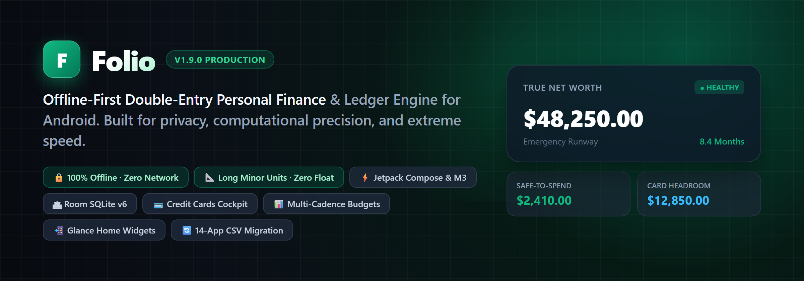
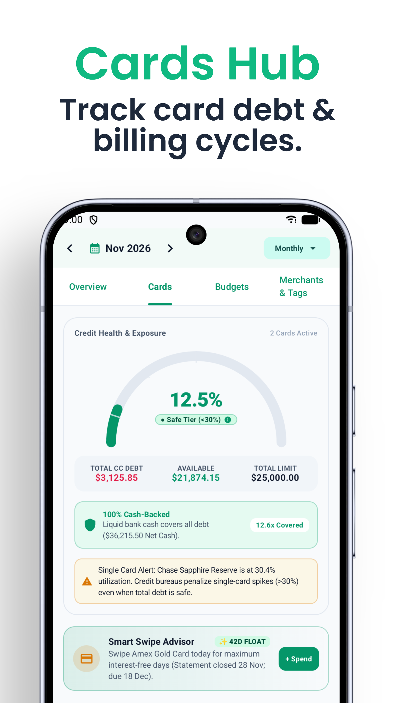
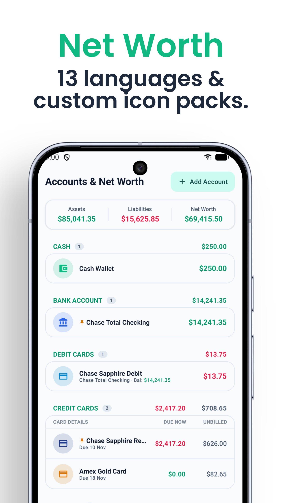
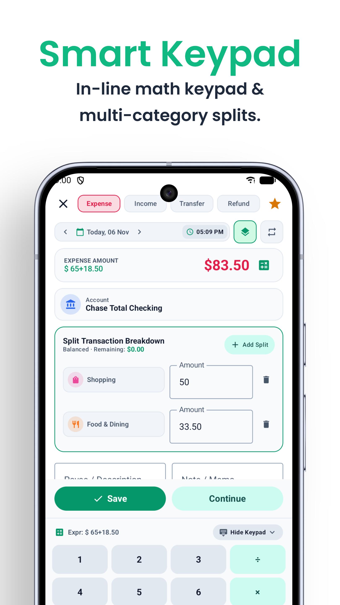
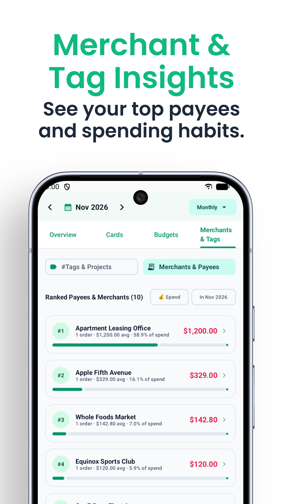

<p align="center">
  <picture>
    <source media="(prefers-color-scheme: dark)" srcset="docs/assets/banner-dark.png">
    <source media="(prefers-color-scheme: light)" srcset="docs/assets/banner-light.png">
    
  </picture>
</p>

<p align="center">
  <strong>An offline-first, double-entry personal finance ledger and budgeting application for Android.</strong><br>
  Built for uncompromising privacy, exact arithmetic precision, and high-performance fluid interactions.
</p>

<p align="center">
  <a href="#core-features">Features</a> •
  <a href="#screenshots">Screenshots</a> •
  <a href="#architecture--invariants">Architecture</a> •
  <a href="#engineering-documentation">Docs</a> •
  <a href="#getting-started">Getting Started</a> •
  <a href="CHANGELOG.md">Changelog</a>
</p>

<p align="center">
  
  
  
  
  
  
</p>

---

## Overview

**Folio** is a native Android personal finance manager designed from the ground up on modern Android architecture. Unlike typical cloud-synced budget apps that monetize user data or suffer from network latency and sync conflicts, Folio operates **100% offline** with **zero internet permissions** in release builds.

Every transaction, balance, and statement is maintained in an encrypted local SQLite database using strict double-entry principles and exact integer math (`MinorMoney`), eliminating rounding errors and floating-point drift entirely.

---

## Core Features

- **Double-Entry Multi-Account Ledger**
  - Full tracking across Cash, Checking, Savings, Credit Cards, Investments, and Loans.
  - Multi-currency support with custom secondary exchange rates and dynamic net worth valuation.
  - Interactive calendar view with daily cashflow heatmaps, bidirectional transfer badges, and sticky daily date headers.
  
- **Credit Cards Cockpit & Financial Intelligence**
  - Automated statement cycle timeline, grace period tracking, and 30% credit bureau utilization benchmarking.
  - Real-time **Discretionary Safe-to-Spend** radar protecting card liabilities and 14-day upcoming recurring commitments.
  - Emergency runway projection, net worth velocity, and merchant outlay cadence intelligence.

- **Multi-Cadence & Rollover Budgets Engine**
  - Flexible budget cadences: Weekly, Bi-Weekly (14-day anchor cycle), Monthly, Quarterly (aligned with fiscal year), Annual, and Custom Date Ranges.
  - Pure zero-drift rollover replay engine computing carryover directly from historical transaction records.
  - Pacing indicators (target vs. actual spend) and pinned Trips & Events budgeting.

- **Jetpack Glance Home Screen Widgets & Quick Settings**
  - Zero-polling, event-driven Glance AppWidgets (`Quick-Add Strip` and `Safe-to-Spend & Daily Pulse`).
  - System Quick Settings Tile for instant transaction logging.
  - Interactive eye mask balance privacy toggle synced with app biometric preferences.

- **14-App Competitor CSV Migration Engine**
  - 100% offline, zero-network pre-normalization bridge for 14 personal finance apps (Ivy Wallet, Cashew, Money Manager, Wallet by BudgetBakers, Money Lover, YNAB, Mint, Spendee, Monefy, 1Money, Bluecoins, Financisto, etc.).
  - Automatic UTF-8/UTF-16 BOM detection, RFC 4180 quote-aware delimiter resolution, and 2-row transfer consolidation.

- **Vector PDF Passbooks & Rolling Auto-Backup**
  - Zero-dependency Skia vector PDF generator producing branded bank passbooks and annual tax statements.
  - Tiered rolling session auto-backup engine (hourly, daily, weekly) with dual local and SAF storage.

- **Privacy & Security**
  - Biometric authentication (Fingerprint / Face Unlock / PIN) guarding app entry, settlements, and widget deep links.
  - Stripped `INTERNET` and `ACCESS_NETWORK_STATE` permissions in release manifests.

---

## Screenshots

<table align="center">
  <tr>
    <td align="center" width="25%">
      <br>
      <b>Daily Cashflow Ledger</b>
    </td>
    <td align="center" width="25%">
      <br>
      <b>Calendar Cashflow</b>
    </td>
    <td align="center" width="25%">
      <br>
      <b>Credit Cards Cockpit</b>
    </td>
    <td align="center" width="25%">
      <br>
      <b>Rollover Budgets</b>
    </td>
  </tr>
  <tr>
    <td align="center" width="25%">
      <br>
      <b>Net Worth & Accounts</b>
    </td>
    <td align="center" width="25%">
      <br>
      <b>Smart Split Keypad</b>
    </td>
    <td align="center" width="25%">
      <br>
      <b>Tags & Trips Hub</b>
    </td>
    <td align="center" width="25%">
      <br>
      <b>Themes & Biometrics</b>
    </td>
  </tr>
</table>

---

## Architecture & Invariants

Folio follows Clean Architecture principles with strict package boundaries, manual dependency injection (`AppContainer`), and a decoupled Kotlin domain layer.

```
app/src/main/java/com/folioledger/app/
├── data/              # Room SQLite database (v6), DAOs, DataStore preferences, Repositories
├── domain/            # Pure Kotlin domain models, calculators, engines, repository contracts
│   ├── model/         # MinorMoney, Transaction, Account, Budget, RecurringRule
│   ├── repository/    # Clean interface contracts implemented by the data layer
│   ├── usecase/       # AccountingRulesEngine, BudgetWindowCalculator, DueRemindersEvaluator
│   └── util/          # MoneyFormatterAndCalculator, CompetitorCsvParser
└── ui/                # Jetpack Compose M3 presentation layer, ViewModels, navigation
    ├── accounts/      # Net worth valuation, account groups, credit card settlements
    ├── ledger/        # Daily, Calendar, Weekly, Monthly, and Summary sub-tabs
    ├── stats/         # Analytics, credit card cockpit, merchant intelligence, budgets
    ├── theme/         # 6 theme modes (Light, Sepia, Slate Gray, Dark, AMOLED) & 12 palettes
    └── widget/        # Jetpack Glance widgets and Android Quick Settings Tile
```

### The 4 Non-Negotiable Invariants

1. **Zero Floating-Point Money:** All monetary amounts are stored and calculated as exact `Long` minor units (`MinorMoney`). `BigDecimal` with explicit `RoundingMode.HALF_UP` is strictly reserved for division, multi-currency exchange rates, and percentage ratios.
2. **100% Offline Privacy:** Release builds strip both `android.permission.INTERNET` and `android.permission.ACCESS_NETWORK_STATE`. In-app tip jar billing uses Android IPC Binder to Google Play Services exclusively.
3. **Non-Destructive Schema Evolution:** `FolioDatabase` (v6) uses explicit `Migration` paths paired with pre-migration SQLite + WAL backups (`DatabaseBackupManager`). Destructive migrations are prohibited.
4. **Zero-Allocation Canvas Rendering:** Custom financial charts render directly to Compose `Canvas` using pre-allocated drawing objects for consistent 120 FPS frame timing.

---

## Engineering Documentation

Detailed specifications and architectural guides are available in [`docs/`](docs/):

| Guide | Description |
| :--- | :--- |
| [**Architecture Overview**](docs/ARCHITECTURE.md) | High-level index, component breakdown, and DI wiring. |
| [**01: Accounting & Domain Rules**](docs/01_ACCOUNTING_AND_DOMAIN_RULES.md) | `MinorMoney` arithmetic, double-entry rules, and credit card statement cycle math. |
| [**02: System Architecture & Schema**](docs/02_ARCHITECTURE_AND_SCHEMA.md) | Room SQLite v6 schema, migration strategies (`MIGRATION_1_2` to `MIGRATION_5_6`), and backup engines. |
| [**03: UI Design System & Material 3**](docs/03_UI_DESIGN_SYSTEM.md) | 6 theme modes, 12 accent palettes, typography standards, and Compose performance rules. |
| [**04: Shared Contracts & Models**](docs/04_SHARED_CONTRACTS.md) | Core domain entities, repository contracts, and UI state models. |

---

## Getting Started

### Prerequisites
- Android Studio Ladybug (2024.2.1+) or newer
- JDK 17 or JDK 21 (configured as Gradle JDK)
- Android SDK 35 (Android 15) with Build Tools 35.0.0

### Building from Source

```bash
# Clone the repository
git clone https://github.com/folio-ledger/folio.git
cd folio

# Build debug APK
./gradlew assembleDebug

# Run JVM unit tests (240+ tests)
./gradlew testDebugUnitTest
```

The compiled APK will be generated at `app/build/outputs/apk/debug/app-debug.apk`.

---

## Contributing

Contributions are welcome! Please read our [**Contributing Guide**](CONTRIBUTING.md) and adhere to the [Code of Conduct](CONTRIBUTING.md#code-of-conduct) and architectural invariants before submitting a pull request.

---

## License

Folio is open-source software licensed under the Apache License 2.0. See [LICENSE](LICENSE) for full details.
