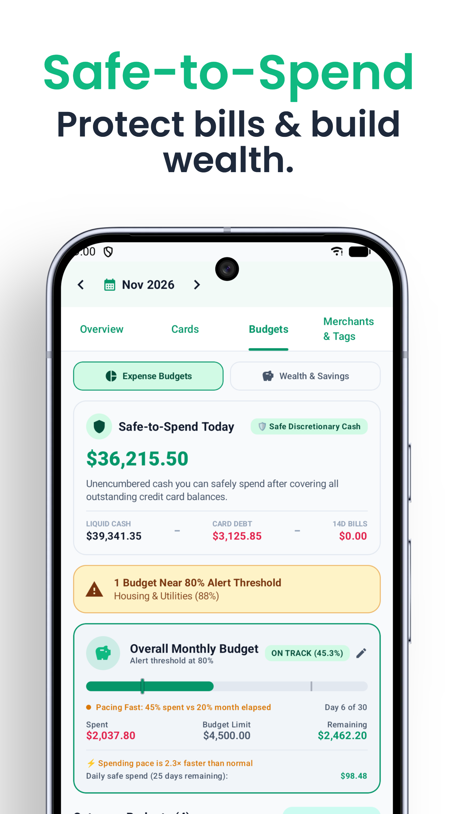
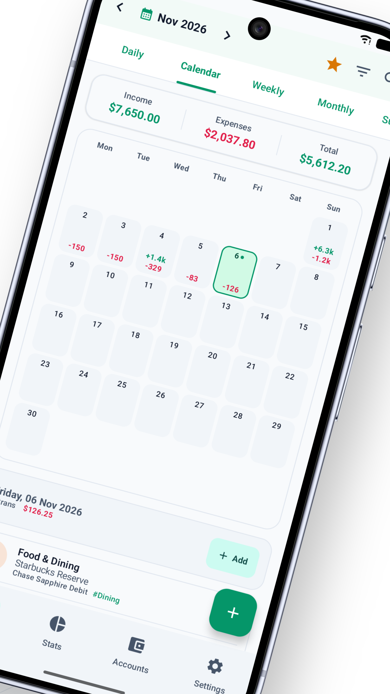
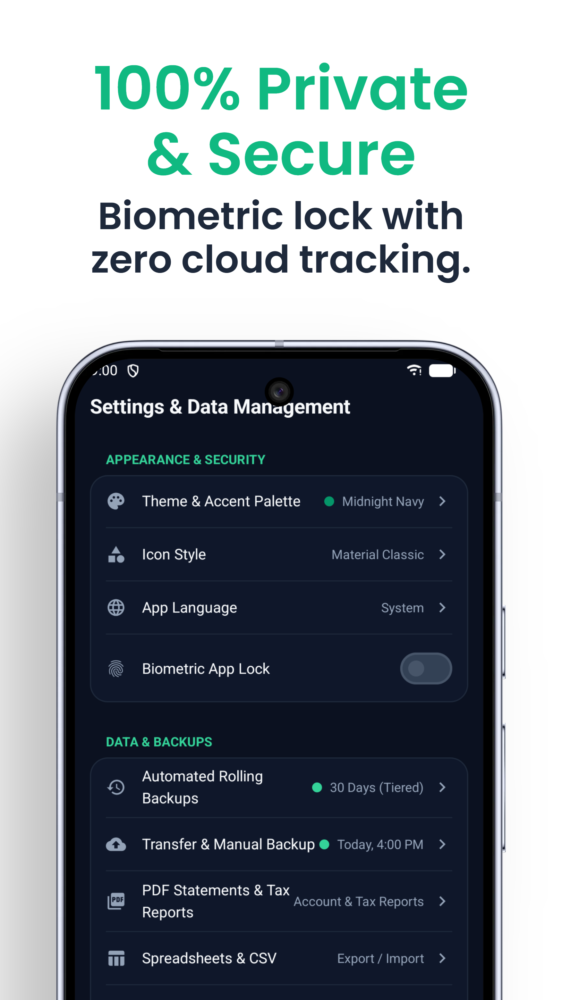

<div align="center">
  

  # Folio

  **Offline-first personal finance, double-entry ledger & credit card cockpit for Android.**

  *Zero internet permissions · Zero ads · Zero paywalls · 100% local SQLite*

  <p>
    <a href="https://play.google.com/store/apps/details?id=com.skal.folio">
      
    </a>
    <a href="https://github.com/SK-App-Labs/folio/releases/latest">
      
    </a>
    <a href="https://github.com/SK-App-Labs/folio/actions/workflows/ci.yml">
      
    </a>
    <a href="LICENSE">
      
    </a>
  </p>

  <p>
    <a href="#screenshots">Screenshots</a> ·
    <a href="#why-folio">Why Folio</a> ·
    <a href="#verify-zero-network-privacy">Privacy Proof</a> ·
    <a href="#architecture--engineering">Architecture</a> ·
    <a href="#build-from-source">Build</a> ·
    <a href="ROADMAP.md">Roadmap</a>
  </p>
</div>

---

## Screenshots

<div align="center">
  <table>
    <tr>
      <td align="center" width="25%">
        <br />
        <sub><b>Daily Ledger</b></sub>
      </td>
      <td align="center" width="25%">
        <br />
        <sub><b>Credit Cards Cockpit</b></sub>
      </td>
      <td align="center" width="25%">
        <br />
        <sub><b>Rollover Budgets</b></sub>
      </td>
      <td align="center" width="25%">
        <br />
        <sub><b>Accounts & Passbooks</b></sub>
      </td>
    </tr>
  </table>
</div>

<details>
  <summary><b>View more screens (Calendar, Math Keypad, Tags & Trips, Settings)</b></summary>
  <br />
  <div align="center">
    <table>
      <tr>
        <td align="center" width="25%">
          <br />
          <sub><b>Calendar Grid</b></sub>
        </td>
        <td align="center" width="25%">
          <br />
          <sub><b>Math Keypad & Entry</b></sub>
        </td>
        <td align="center" width="25%">
          <br />
          <sub><b>Trips & Reimbursements</b></sub>
        </td>
        <td align="center" width="25%">
          <br />
          <sub><b>Themes & Backups</b></sub>
        </td>
      </tr>
    </table>
  </div>
</details>

---

## Why Folio

Most finance apps scrape your SMS inbox, sync your spending to remote servers, or gate core budgeting behind monthly subscriptions. **Folio is built on a single premise: your ledger belongs strictly on your device.**

| Capability | What Folio Ships |
| :--- | :--- |
| **5-View Ledger** | Daily receipt feed, Calendar cashflow grid, Weekly burn buckets, 12-Month overview, and Financial Summary with Savings Rate %. |
| **Credit Cards Cockpit** | Separates *Statement Due* vs. *Unbilled Spend*, 30% bureau utilization gauges, Smart Swipe grace-period advisor, EMI installments, and 1-tap `CC_SETTLEMENT` without double-counting expenses. |
| **Multi-Cadence & Rollover Budgets** | Weekly, Bi-Weekly, Monthly, Quarterly, Annual, and Custom Trip/Event budgets with zero-drift immutable ledger rollover replay and pacing needles. |
| **Forward-Looking Intelligence** | True *Safe-to-Spend* cash (ring-fencing card debt & 14-day recurring bills), Overdraft Shortfall Radar, Net Worth Velocity, Emergency Runway, and Wealth Vaults. |
| **Fast Entry & Widgets** | Live math keypad (`+ − × ÷`), deterministic payee autofill, 1-to-N splits, refunds, Jetpack Glance home-screen widgets (with 1-tap privacy mask), and Android Quick Settings tile. |
| **14-App Offline Migration** | Zero-server CSV migration presets for Ivy Wallet, Cashew, Money Manager, Wallet by BudgetBakers, Money Lover, YNAB, Mint, Spendee, Monefy, 1Money, Bluecoins, Financisto, and more. |
| **Portable Ownership** | On-device Skia vector PDF passbooks & annual tax statements, rolling automatic local ZIP backups, formula-safe CSV exports, and 170+ currencies with offline FX rates. |
| **Calm Personalization** | 6 theme modes (System, Light, Sepia, Slate Gray, Dark, AMOLED Black), 12 accent palettes, 4 icon packs, 13 languages (Android 13+ Per-App Language), and Biometric App Lock. |

---

## Verify Zero-Network Privacy

Folio does not merely promise not to track you—**the Android OS blocks it from opening a network socket.**

Even transitive network permissions pulled in by AndroidX libraries are explicitly stripped at manifest merge time in [`app/src/main/AndroidManifest.xml`](app/src/main/AndroidManifest.xml):

```xml
<uses-permission android:name="android.permission.INTERNET" tools:node="remove" />
<uses-permission android:name="android.permission.ACCESS_NETWORK_STATE" tools:node="remove" />
```

You can independently verify the installed APK on any device:

```bash
adb shell dumpsys package com.skal.folio | grep permission
```

- **Local-only storage:** Room SQLite (`folio_ledger.db`) + Jetpack Preferences DataStore.
- **Zero cloud auto-sync:** Cloud backup of databases, preferences, and local exports is explicitly excluded in `backup_rules.xml` and `data_extraction_rules.xml`.
- **Privacy Policy:** [Read our full Privacy Policy](https://sites.google.com/view/folio-ledger-privacy/home).

---

## Architecture & Engineering

Folio is written 100% in Kotlin with Jetpack Compose and Material 3, using manual dependency injection (`AppContainer` + `FolioViewModelFactory`) for fast builds, zero reflection overhead, and transparent data flow.

### Core Engineering Invariants

- **Exact Integer Money (`MinorMoney`):** All financial math runs in `Long` minor units (paise/cents/yen) with saturating overflow guards (`safeAdd`, `safeSubtract`). Zero `Float` or `Double` currency math.
- **Immutable Opening Anchors:** Post-creation balance corrections generate explicit `RECONCILIATION` ledger entries rather than silently rewriting historical opening balances.
- **Non-Destructive Room Migrations:** Schema history (`1.json` → `6.json`) is exported and validated with explicit `Migration` paths and automatic `.pre_migration_bak` rollback protection.
- **Lifecycle-Safe Reactive State:** Single-Activity MVVM with `StateFlow` + `SharingStarted.WhileSubscribed(5_000)` and Macrobenchmark Baseline Profiles (`:macrobenchmark`).

### Tech Stack

- **UI:** Jetpack Compose (BOM `2026.02.01`), Material 3, Jetpack Glance (`1.1.1`), SplashScreen API
- **Persistence:** Room SQLite (`2.8.5`) with KSP, Preferences DataStore (`1.1.3`)
- **Background & Security:** WorkManager (`2.10.0`) local reminders, AndroidX Biometric (`1.1.0`)
- **Toolchain:** Kotlin `2.2.10`, AGP `9.5.0`, Compile/Target SDK `37`, Min SDK `29` (Android 10+), Spotless + ktlint

### Deep-Dive Documentation

- [`docs/01_ACCOUNTING_AND_DOMAIN_RULES.md`](docs/01_ACCOUNTING_AND_DOMAIN_RULES.md) — Double-entry rules, transfers, credit card cycles, and rollover math
- [`docs/02_ARCHITECTURE_AND_SCHEMA.md`](docs/02_ARCHITECTURE_AND_SCHEMA.md) — Layers, Room entities, and migrations
- [`docs/03_UI_DESIGN_SYSTEM.md`](docs/03_UI_DESIGN_SYSTEM.md) — Material 3 tokens, typography, and motion craft
- [`CHANGELOG.md`](CHANGELOG.md) — Detailed version history

---

## Build from Source

### Prerequisites

- Android Studio (latest Canary/Stable supporting AGP 9.5.0 & Gradle 9.6.0)
- JDK 17+
- Android SDK 37

### Clone, Test & Run

```bash
git clone https://github.com/SK-App-Labs/folio.git
cd folio

# Check formatting (Spotless / ktlint)
./gradlew spotlessCheck

# Run JVM unit test suite
./gradlew testDebugUnitTest

# Build debug APK (no signing keystore required)
./gradlew assembleDebug
```

> **Note on Release Builds:** Release signing reads `keystore.properties` from the project root (ignored by Git). On local machines without `keystore.properties`, release builds fall back to the debug key; CI release builds fail fast if signing credentials are missing.

---

## Contributing & Support

Contributions, bug reports, translations, and architecture reviews are warmly welcome. Please read [CONTRIBUTING.md](CONTRIBUTING.md) and [SECURITY.md](SECURITY.md) before opening a pull request.

Found a bug or have an idea? Open an [Issue](https://github.com/SK-App-Labs/folio/issues) or start a [Discussion](https://github.com/SK-App-Labs/folio/discussions).

Enjoy using Folio? Star this repository, leave a review on [Google Play](https://play.google.com/store/apps/details?id=com.skal.folio), or support independent development via the voluntary in-app Tip Jar.

<div align="center"><sub>Built independently with calm craft and zero compromises on privacy.</sub></div>
